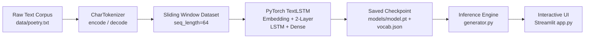

# ⚡ LSTM Deep Sequence Generator

A production-ready character-level sequence generation system built with **PyTorch** and **Streamlit**. It implements an autoregressive Long Short-Term Memory (LSTM) recurrent neural network with temperature-scaled softmax sampling and an interactive, modern web frontend.

---

## 🌟 Key Features

- **Bidirectional Character Tokenizer**: Converts text to tokens with `<unk>` fallback handling and JSON serialization.
- **Stacked PyTorch LSTM**: Multi-layer recurrent neural network with continuous token embeddings, configurable hidden state dimensions, and dropout regularization.
- **Temperature-Scaled Softmax Sampling**: Fine-grained stochastic control over next-token generation ($T \in [0.1, 1.5]$) and optional Top-K nucleus filtering.
- **Autoregressive Generation Engine**: Modular inference engine decoupled from training code, with latency & throughput benchmarking.
- **Modern Streamlit Dashboard**:
  - Live temperature & length controls.
  - Preset classic poetic seed prompts (Shakespeare, Poe, Blake, Dylan Thomas).
  - Dynamic token probability distribution chart.
  - Model architecture inspector & training loss curves.
  - In-app 1-click model training option.

---

## 🏗️ System Architecture



### Mathematical Sampling Formulation

Given the final hidden state projecting unnormalized logits $\mathbf{z} \in \mathbb{R}^{V}$:

$$P(w_i) = \frac{\exp(z_i / T)}{\sum_{j=1}^{V} \exp(z_j / T)}$$

- **Low Temperature ($T < 0.5$)**: Peaked probability distribution. Confident, conservative, and deterministic tokens.
- **Balanced ($T \approx 0.7$)**: Balanced entropy. Produces coherent rhyme, meter, and lyrical variation.
- **High Temperature ($T > 1.0$)**: Flattened uniform distribution. High entropy, surprising vocabulary, and creative variations.

---

## 📂 Project Directory Structure

```text
lstm-sequence-generator/
├── data/
│   └── poetry.txt          # Raw text training corpus (poetry & lyrics)
├── models/
│   ├── model.pt            # Serialized PyTorch LSTM checkpoint weights
│   └── vocab.json          # Serialized character vocabulary mapping
├── model.py                # PyTorch LSTM neural network definition
├── train.py                # Preprocessing, tokenization & training pipeline
├── generator.py            # Inference engine with temperature & top-k sampling
├── app.py                  # Streamlit web application frontend
├── requirements.txt        # Python dependency manifest
└── README.md               # Architecture documentation & guide
```

---

## 🚀 Quickstart Guide

### 1. Install Dependencies
```bash
pip install -r requirements.txt
```

### 2. Train the LSTM Model
Train the model on the included poetry corpus:
```bash
python train.py --epochs 25 --batch_size 32 --seq_length 64 --hidden_dim 256
```

#### Training Options:
| Argument | Default | Description |
|---|---|---|
| `--data` | `data/poetry.txt` | Path to text corpus |
| `--epochs` | `20` | Number of training epochs |
| `--batch_size` | `32` | Minibatch size |
| `--seq_length` | `64` | Sliding window context length |
| `--embedding_dim` | `128` | Token vector dimension |
| `--hidden_dim` | `256` | LSTM cell hidden units |
| `--num_layers` | `2` | Stacked LSTM layer count |
| `--dropout` | `0.2` | Regularization dropout rate |
| `--lr` | `0.003` | AdamW learning rate |
| `--model_dir` | `models` | Output directory for checkpoint & vocab |

### 3. Launch the Streamlit Web Application
```bash
streamlit run app.py
```
Open [http://localhost:8501](http://localhost:8501) in your browser.

---

## 💻 Python API Usage Example

```python
from generator import TextGenerator

# Initialize inference engine
gen = TextGenerator(model_path="models/model.pt", vocab_path="models/vocab.json")

# Generate sequence with temperature scaling
output = gen.generate(
    seed_prompt="Shall I compare thee to a summer's day?",
    max_length=200,
    temperature=0.75,
    top_k=10
)

print(output["generated_text"])
```
